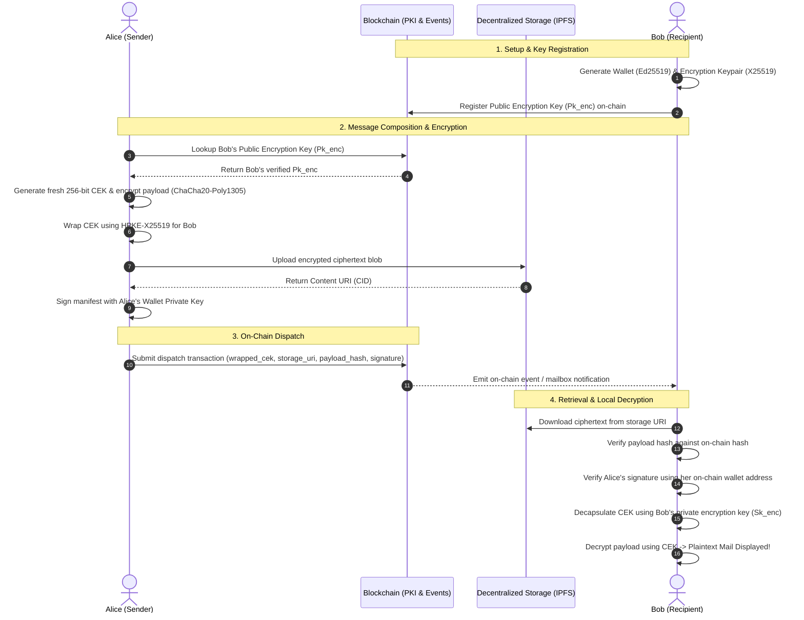

# Blockchain End-to-End Encrypted Mail (B-Mail)

[](Plan.md)
[](Protocol.md)
[](LICENSE)

**B-Mail** is a decentralized, blockchain-native email protocol providing **true End-to-End Encryption (E2EE)**. By using the blockchain as a tamper-proof Public Key Infrastructure (PKI) and notification layer, mail can **only be read (decrypted) by the intended recipient**.

---

## 1. How It Works



---

## 2. Key Architecture Principles

### 2.1 Cryptographic Separation of Keys
In B-Mail, wallet signing keys and message encryption keys are strictly separated:
- **Blockchain Wallet Key (`Ed25519`):** Authorizes transactions, registers keys, and signs outgoing mail manifests for sender authentication.
- **Device Encryption Key (`X25519`):** Diffie-Hellman / HPKE asymmetric key used solely to wrap Content Encryption Keys (CEKs). **The private encryption key NEVER leaves the user's local device.**

### 2.2 End-to-End Encryption (E2EE) Mechanism
1. Every message has a unique, cryptographically random 256-bit **Content Encryption Key (CEK)**.
2. The payload (subject, body, attachments) is encrypted using **ChaCha20-Poly1305** authenticated encryption.
3. The CEK is encapsulated using **HPKE (RFC 9180)** using the recipient's registered public encryption key (`Pk_enc`).
4. **Mathematical Guarantee:** Only the holder of the recipient's private encryption key (`Sk_enc`) can unwrap the CEK and decrypt the payload. Validators, miners, storage relays, and network eavesdroppers cannot access the message content.

### 2.3 Decentralized PKI (No Central Authority)
Traditional encryption systems suffer from key-substitution attacks (MITM). In B-Mail:
- Public keys are stored directly in smart contract state on the blockchain.
- Anyone can verify key ownership and history transparently without relying on centralized certificate authorities.

---

## 3. Security Properties & Threat Model

| Security Property | Mechanism | Threat Prevented |
|---|---|---|
| **End-to-End Confidentiality** | HPKE (X25519) + ChaCha20-Poly1305 | Blockchain nodes, miners, storage hosts, and network observers cannot read mail. |
| **Sender Authenticity** | Wallet digital signatures (`Ed25519`) | Prevents mail forgery, spoofing, and sender impersonation. |
| **Message Integrity** | Poly1305 AEAD tag + SHA-256 payload digest | Any alteration of ciphertext or storage payload causes immediate rejection. |
| **Tamper-Proof Keys** | Blockchain consensus state | Prevents Man-in-the-Middle (MITM) public key substitution. |
| **Zero Plaintext Leakage** | All sensitive metadata (Subject, Body, Attachments) encrypted inside payload | Only sender address, recipient address, and timestamp are visible on-chain. |
| **Fail-Closed Security** | Strict protocol verification | If recipient is unregistered or signatures fail, the message is never sent in plaintext. |

---

## 4. Repository Layout

```text
.
├── README.md                      # High-level architecture and quickstart (this file)
├── Protocol.md                    # Normative protocol specification
├── Plan.md                        # Master implementation and execution plan
├── rust-toolchain.toml            # Pinned Rust compiler toolchain
├── Cargo.toml                     # Cargo workspace definition
│
├── crates/
│   ├── bmail-crypto/              # X25519, Ed25519, HPKE CEK wrapping, ChaCha20-Poly1305
│   ├── bmail-types/               # Protocol identifiers, envelopes, serialization
│   ├── bmail-storage/             # Content-addressed encrypted payload storage
│   ├── bmail-chain/               # Smart contract / blockchain interface & local simulator
│   └── bmail-sdk/                 # High-level client SDK orchestrating E2EE workflow
│
├── programs/
│   └── bmail-registry/            # On-chain smart contract (Solana Anchor / EVM)
│
├── clients/
│   └── bmail-cli/                 # Reference CLI tool (init, register, send, inbox, read)
│
└── tests/
    └── e2e_test.rs                # End-to-end integration test proving E2EE security
```

---

## 5. Implementation Roadmap

The implementation follows the structured phases defined in [Plan.md](Plan.md):

- [ ] **Phase 0:** Workspace Bootstrap & Environment Controls
- [ ] **Phase 1:** Cryptographic Engine (`bmail-crypto`: X25519, HPKE, ChaCha20-Poly1305)
- [ ] **Phase 2:** Protocol Types & Wire Serialization (`bmail-types`)
- [ ] **Phase 3:** Blockchain Interface & Smart Contract Registry (`bmail-chain`)
- [ ] **Phase 4:** Content-Addressed Storage Adapter (`bmail-storage`)
- [ ] **Phase 5:** Unified Client SDK (`bmail-sdk`)
- [ ] **Phase 6:** Reference CLI & Automated E2E Security Test Suite (`bmail-cli`)

Refer to [Plan.md](Plan.md) for detailed task requirements and acceptance criteria.

## 5. Quickstart: Running the POC

### Running the End-to-End Demo
To run the full multi-party E2EE demonstration (Alice sends confidential mail to Bob, Bob decrypts on his device, and an unauthorized observer Charlie fails to decrypt):

```bash
cargo run -p bmail-cli -- demo
```

### Running All Unit and Integration Tests
```bash
# Run all workspace unit tests and cryptographic security tests
cargo test --workspace

# Run code style and lint checks
cargo fmt --all -- --check
cargo clippy --workspace --all-targets -- -D warnings
```

### Generating a Solana-Compatible Wallet
```bash
cargo run -p bmail-cli -- generate-wallet
```

---

## 6. Implementation Architecture Details

- [Protocol.md](Protocol.md) — Comprehensive technical protocol specification.
- [Plan.md](Plan.md) — Step-by-step engineering execution plan.
