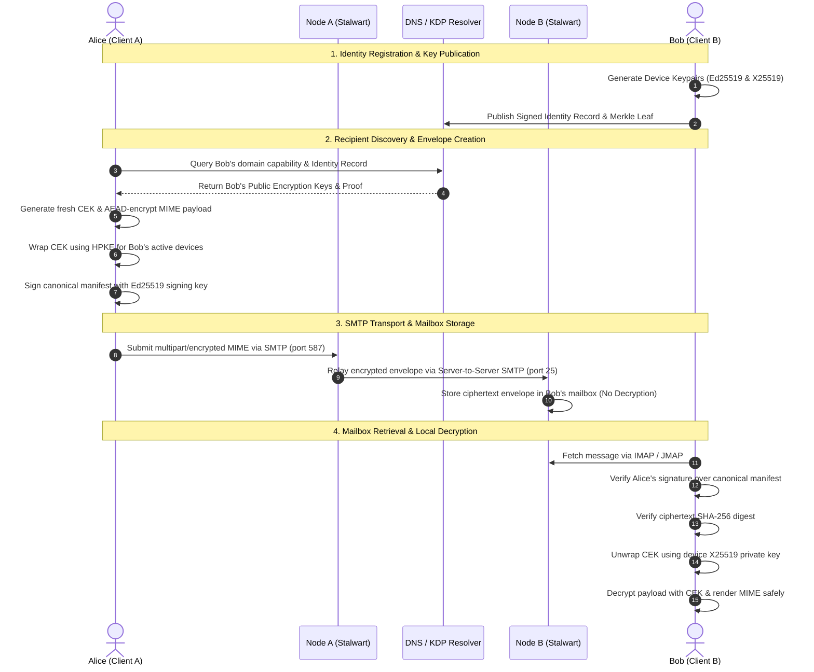

# Decentralized Mail Network (DMN)

[](docs/Plan.md)
[](LICENSE)

The **Decentralized Mail Network (DMN)** is an open, federated email architecture that brings native client-side End-to-End Encryption (E2EE), portable cryptographic identities, and auditable key transparency to standard Internet email without breaking existing protocols (SMTP, MIME, IMAP, JMAP).

---

## Table of Contents

1. [Executive Summary](#1-executive-summary)
2. [How It Works: End-to-End Flow](#2-how-it-works-end-to-end-flow)
3. [System Architecture](#3-system-architecture)
4. [Protocol Details](#4-protocol-details)
   - [Identity Protocol (DID-MAIL)](#41-identity-protocol-did-mail)
   - [Key Discovery Protocol (KDP)](#42-key-discovery-protocol-kdp)
   - [Secure Message Envelope (SME)](#43-secure-message-envelope-sme)
   - [SMTP & MIME Binding](#44-smtp--mime-binding)
   - [Federation Protocol (DFP)](#45-federation-protocol-dfp)
5. [Security & Threat Model](#5-security--threat-model)
6. [Technology Stack](#6-technology-stack)
7. [Repository Layout](#7-repository-layout)
8. [Local Development & Quickstart](#8-local-development--quickstart)
9. [Documentation Index](#9-documentation-index)

---

## 1. Executive Summary

Traditional email lacks modern, turnkey end-to-end encryption and relies on centralized trust anchors. DMN bridges modern cryptography with established email infrastructure:

- **Zero Server Plaintext:** Mail transfer agents (MTAs), relays, and storage providers handle only ciphertext envelopes. They never possess Content Encryption Keys (CEKs) or private keys.
- **Fail-Closed Security:** Messages explicitly marked for encryption never silently downgrade to plaintext under any failure condition.
- **Standards Compliant:** Transports messages over standard SMTP and stores them in unmodified Stalwart mailboxes accessible via IMAP and JMAP.
- **Auditable Key Transparency:** Key lifecycle events (enrollment, rotation, revocation) are immutably logged in an append-only Merkle tree, with optional checkpoint commitments anchored on Solana.
- **Decoupled Blockchain:** Blockchain availability is strictly optional. SMTP delivery continues uninterrupted during blockchain latency or outages.

---

## 2. How It Works: End-to-End Flow



### Step-by-Step Workflow

1. **Identity & Device Enrollment:**
   - The user generates an Identity Authority Key, a Device Signing Key (Ed25519), and a Device Encryption Key (X25519) locally on their endpoint.
   - The client proves control of the email address/domain and signs an identity record that binds the public keys to the identity.
   - The record is appended to the operator's Key Transparency Log and published to the directory.
2. **Key Discovery:**
   - When composing to `bob@domain-b.org`, Alice's client queries the DNS TXT record `_dmn.domain-b.org` (or fallback `/.well-known/dmn`).
   - Alice fetches Bob's verified identity record, checks active devices, and verifies the transparency inclusion proof.
3. **Payload Encryption & Manifest Signing:**
   - Alice's client generates a cryptographically secure 32-byte Content Encryption Key (CEK).
   - The payload (confidential subject, text, HTML, and attachments) is encrypted using ChaCha20-Poly1305.
   - For every authorized device registered to Bob (and CC recipients), the CEK is encapsulated using HPKE (RFC 9180 Base Mode with X25519).
   - A canonical manifest (binding version, message ID, ciphertext hash, sender key ID) is generated via Deterministic CBOR and signed with Alice's Ed25519 key.
4. **SMTP Carriage:**
   - The resulting Secure Message Envelope is packed as a `multipart/encrypted` MIME message with neutral outer headers (`Subject: Encrypted Message`).
   - Alice's client submits the message to Node A via standard authenticated SMTP.
   - Node A routes the message over standard SMTP to Node B.
5. **Decryption on Recipient Device:**
   - Node B stores the encrypted MIME message in Bob's mailbox without decrypting it.
   - Bob's client retrieves the message over IMAP or JMAP.
   - Bob's client verifies Alice's manifest signature, confirms the ciphertext hash, unwraps the CEK using its local private key, and decrypts the payload.

---

## 3. System Architecture

```text
+-----------------------------------------------------------+
|                       User Clients                         |
|             CLI / Web Client / Mobile Endpoints            |
|                                                           |
|  [Identity Vault]  [Encrypt & Sign]  [Decrypt & Verify]   |
+-------------------------------+---------------------------+
                                |
                     HTTPS / JMAP / SMTP submission
                                |
+-------------------------------v---------------------------+
|                    DMN Mail Node                           |
|                                                           |
|  SMTP MTA | IMAP/JMAP | Mailbox | Queue | Policy/Spam      |
|                                                           |
|  +------------------- DMN Services ---------------------+  |
|  | Identity resolver | Key cache | Federation adapter  |  |
|  | E2EE MIME handler | Delivery state | Notifications   |  |
|  +------------------------------------------------------+  |
+-------------+------------------+--------------------------+
              |                  |
       +------v------+    +------v----------------+
       | PostgreSQL  |    | Encrypted Object Store|
       | metadata    |    | MIME blobs/attachments|
       +-------------+    +-----------------------+
              |
       +------v-----------------------------------+
       | Identity & Trust Infrastructure           |
       | DNS / DNSSEC / Key Directory / Merkle Log|
       | Optional Solana Identity Registry        |
       +-------------------------------------------+
```

### Component Responsibilities

| Component | Responsibility | Technical Implementation |
|---|---|---|
| **Client SDK** | Key generation, envelope creation, signing, unwrapping, and decryption. | Rust library (`dmn-client-sdk`) |
| **Mail Server** | Standard SMTP submission, queue routing, MX relay, and IMAP/JMAP mailboxes. | Stalwart Mail Server (unmodified) |
| **Identity Service** | Domain challenge verification, identity record registration, and key lookup. | Rust service + PostgreSQL |
| **Transparency Log**| Append-only Merkle tree storing key lifecycle events and inclusion proofs. | Rust Merkle service |
| **Object Store** | Storage of large encrypted message bodies and encrypted attachments. | S3-compatible storage (MinIO locally) |
| **Trust Anchor** | Optional public witness for periodic Merkle roots and domain authorities. | Solana Program (Rust / Anchor) |

---

## 4. Protocol Details

### 4.1 Identity Protocol (DID-MAIL)

Identities represent human-readable email addresses (`local_part@domain.tld`). Key purposes are strictly separated:
- **Identity Signing Key:** Authorizes new devices and overall identity updates.
- **Device Signing Key (Ed25519):** Signs message manifests and client requests.
- **Device Encryption Key (X25519):** Receives encapsulated CEKs via HPKE.

```json
{
  "protocol": "did-mail/1",
  "identity_id": "base64url-32-bytes",
  "address": "bob@domain-b.org",
  "domain": "domain-b.org",
  "authority_key_id": "auth-key-01",
  "identity_signing_keys": [
    {
      "key_id": "auth-key-01",
      "algorithm": "Ed25519",
      "public_key": "base64url-32-bytes",
      "status": "active"
    }
  ],
  "devices": [
    {
      "device_id": "base64url-16-bytes",
      "device_signing_key": {
        "key_id": "dev-sig-01",
        "algorithm": "Ed25519",
        "public_key": "base64url-32-bytes"
      },
      "device_encryption_key": {
        "key_id": "dev-enc-01",
        "algorithm": "HPKE-X25519",
        "public_key": "base64url-32-bytes"
      },
      "status": "active"
    }
  ],
  "version": 1,
  "created_at": 1731866400,
  "authority_signature": "base64url-64-bytes"
}
```

### 4.2 Key Discovery Protocol (KDP)

1. **DNS TXT Discovery:** Resolves `_dmn.<domain>`:
   ```text
   v=DMN1; idp=https://identity.domain-b.org/v1; ktl=https://ktl.domain-b.org/v1
   ```
2. **Well-Known Fallback:** Queries `https://<domain>/.well-known/dmn` over HTTPS.
3. **Record Validation:** Verifies the domain authority signature, checks expiry, and confirms the Merkle transparency inclusion proof.

### 4.3 Secure Message Envelope (SME)

The native envelope binds manifest commitments, recipient wrapped keys, and ciphertext:

```json
{
  "protocol": "dmn-sme/1",
  "message_id": "base64url-16-or-32-bytes",
  "created_at": 1731866400,
  "sender": {
    "identity_id": "base64url-32-bytes",
    "key_id": "dev-sig-01"
  },
  "crypto": {
    "content_algorithm": "ChaCha20-Poly1305",
    "key_wrap_algorithm": "HPKE-DHKEM-X25519-HKDF-SHA256-ChaCha20Poly1305"
  },
  "content": {
    "content_type": "application/vnd.dmn.mime",
    "nonce": "base64url-12-bytes",
    "ciphertext": "base64url-bytes",
    "ciphertext_hash": "base64url-sha256"
  },
  "recipient_envelopes": [
    {
      "recipient_identity_id": "base64url-32-bytes",
      "device_id": "base64url-16-bytes",
      "key_id": "dev-enc-01",
      "encapsulation": "base64url-32-bytes",
      "wrapped_cek": "base64url-bytes"
    }
  ],
  "signature": {
    "algorithm": "Ed25519",
    "key_id": "dev-sig-01",
    "value": "base64url-64-bytes"
  }
}
```

*Note: Signatures and hashes are evaluated strictly over **Deterministic CBOR (RFC 8949)** byte representations, never raw JSON.*

### 4.4 SMTP & MIME Binding

- Carried inside standard MIME:
  ```http
  Content-Type: multipart/encrypted; protocol="application/vnd.dmn.envelope"; boundary="--DMN_BOUNDARY"
  ```
- **Outer Headers:** Contain minimal routing information (`From`, `To`, `Message-ID`, `Date`). Outer subject is masked (`Subject: Encrypted Message`).
- **Inner Payload:** Canonical MIME structure containing confidential subject, multipart alternative bodies (text/plain, text/html), and attachments.
- **OpenPGP/MIME:** Supported as a parallel interoperability profile (`multipart/encrypted; protocol="application/pgp-encrypted"`).

### 4.5 Federation Protocol (DFP)

- Operates over standard SMTP (RFC 5321).
- **Delivery State Machine:** `CREATED -> ENCRYPTED -> QUEUED -> SUBMITTED -> ACCEPTED_BY_REMOTE -> DELIVERED_TO_MAILBOX`.
- **Replay Protection:** Unique `message_id` tracking on the recipient node prevents duplicate injection attacks.
- **BCC Confidentiality:** Split delivery ensures BCC recipients receive an independent cryptographic envelope with their own CEK and manifest, preventing recipient enumeration.

---

## 5. Security & Threat Model

| Threat | Mitigation Strategy |
|---|---|
| **Eavesdropping by Mail Relays / MTAs** | Payloads and attachments are encrypted client-side with fresh CEKs. Servers see only ciphertext. |
| **Storage Service Data Breach** | S3/MinIO stores only ciphertext blobs authenticated via AEAD tags. |
| **Ciphertext Modification** | AEAD authentication tags (Poly1305) and SHA-256 manifest commitments fail closed upon tampering. |
| **Sender Impersonation** | Sender Ed25519 digital signature covers the deterministic manifest and ciphertext hash. |
| **Rogue Public Key Insertion** | Append-only Merkle Key Transparency Log detects unauthorized key modifications or split-views. |
| **Downgrade Attacks** | Protocol negotiation enforces mandatory crypto suites. Fallback to unencrypted plaintext requires explicit user consent. |
| **Secret Leakage in Logs** | All secret key types implement zeroization on drop and format as `[REDACTED]` in `Debug` and logs. |

*See [docs/threat-model.md](docs/threat-model.md) for full threat analysis and residual risk disclosures.*

---

## 6. Technology Stack

| Layer | Primary Technology | Standards / Normative Specs |
|---|---|---|
| **Core Workspace** | Rust (2021 edition) | Cargo modular workspace |
| **Digital Signatures** | Ed25519 (`ed25519-dalek`) | RFC 8032 |
| **Public-Key Key Wrapping** | HPKE (`DHKEM(X25519) + ChaCha20Poly1305`) | RFC 9180 |
| **Symmetric Encryption** | ChaCha20-Poly1305 & AES-256-GCM | RFC 8439 / NIST SP 800-38D |
| **Canonical Serialization**| Deterministic CBOR | RFC 8949 Section 4.2.1 |
| **Mail Server Foundation** | Stalwart Mail Server | RFC 5321 (SMTP), RFC 9051 (IMAP), RFC 8620 (JMAP) |
| **Metadata Database** | PostgreSQL 16 | Relational store for identities, devices, and queue states |
| **Object Store** | MinIO (local dev) / S3-compatible | Encrypted blobs and attachments |
| **Optional Blockchain** | Solana Program | Optional on-chain checkpoint commitments |

---

## 7. Repository Layout

```text
.
├── README.md                                  # This documentation
├── rust-toolchain.toml                        # Pinned Rust toolchain
├── rustfmt.toml                               # Code formatting rules
├── Cargo.toml                                 # Cargo workspace definition
├── .env.example                               # Local environment configuration template
├── docs/                                      # Normative documentation and records
│   ├── README.md                              # Documentation directory index
│   ├── Plan.md                                # Master engineering execution plan
│   ├── HLD.md                                 # High-Level Design document
│   ├── Protocol.md                            # Detailed Protocol Specification
│   ├── threat-model.md                        # Threat model and security analysis
│   ├── deployment.md                          # Local deployment and operations guide
│   ├── adr/                                   # Architecture Decision Records (ADRs 0001-0008)
│   └── test-vectors/                          # Cryptographic test fixtures
├── crates/                                    # Modular Rust workspace crates
│   ├── dmn-types/                             # Validated protocol types and identifiers
│   ├── dmn-encoding/                          # Deterministic CBOR & canonical serialization
│   ├── dmn-crypto/                            # HPKE, AEAD, Ed25519, and key generation
│   ├── dmn-identity/                          # Identity records, resolution, and device lifecycle
│   ├── dmn-envelope/                          # Secure Message Envelope (SME) construction
│   ├── dmn-mime/                              # MIME generator, parser, and OpenPGP adapters
│   ├── dmn-transparency/                      # Merkle log, inclusion & consistency proofs
│   └── dmn-client-sdk/                        # Unified client SDK for E2EE operations
├── services/                                  # Backend microservices
│   ├── identity-api/                          # REST/gRPC identity directory service
│   └── transparency-api/                      # Key transparency Merkle service
├── clients/                                   # Client implementations
│   └── cli/                                   # Reference command-line client
└── deploy/                                    # Deployment orchestration
    └── compose/                               # Local Docker Compose setup
```

---

## 8. Local Development & Quickstart

### Prerequisites

- **Rust:** Stable toolchain (`rustup install stable`)
- **Docker & Docker Compose:** v2.20+

### Starting Local Services

```bash
# 1. Copy environment variables
cp .env.example .env

# 2. Launch PostgreSQL, MinIO, and Stalwart
docker compose -f deploy/compose/docker-compose.yml up -d

# 3. Check container health
docker compose -f deploy/compose/docker-compose.yml ps
```

### Building & Running Verification Tests

```bash
# Check code formatting
cargo fmt --all -- --check

# Run linter with zero warnings permitted
cargo clippy --workspace --all-targets -- -D warnings

# Execute workspace unit and integration tests
cargo test --workspace
```

---

## 9. Documentation Index

Detailed architectural and engineering documentation is maintained in `docs/`:

- [docs/Plan.md](docs/Plan.md) — Master Implementation Plan & Phase Gates.
- [docs/HLD.md](docs/HLD.md) — System Architecture & Trust Boundaries.
- [docs/Protocol.md](docs/Protocol.md) — Full Protocol Specification.
- [docs/threat-model.md](docs/threat-model.md) — Threat Model & Security Controls.
- [docs/deployment.md](docs/deployment.md) — Local Development & Deployment Guide.
- [docs/adr/](docs/adr/) — Architecture Decision Records:
  - [ADR 0001: Canonical Serialization](docs/adr/0001-canonical-serialization.md)
  - [ADR 0002: Mandatory Cryptographic Suites](docs/adr/0002-cryptographic-suite.md)
  - [ADR 0003: Native Secure Message Envelope and MIME Binding](docs/adr/0003-native-envelope-and-mime-binding.md)
  - [ADR 0004: Identity Ownership and Device Lifecycle](docs/adr/0004-identity-ownership-and-recovery.md)
  - [ADR 0005: BCC Privacy and Recipient Confidentiality](docs/adr/0005-bcc-privacy.md)
  - [ADR 0006: DNS and Well-Known Capability Discovery](docs/adr/0006-dns-discovery.md)
  - [ADR 0007: Mail Server Integration Architecture (Stalwart)](docs/adr/0007-mail-server-integration.md)
  - [ADR 0008: Blockchain Account Authority (Solana)](docs/adr/0008-blockchain-account-authority.md)
